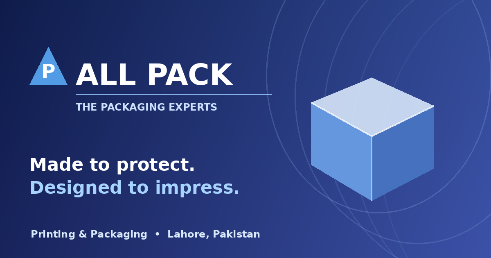

# ALL PACK — The Packaging Experts

Premium Next.js showcase and inquiry website for ALL PACK, a packaging and printing business in Lahore, Pakistan. Source branding and office details were transcribed from the letterhead provided by the business. All public product options are **concepts pending confirmation**; the website does not claim inventory or fixed prices.



## Stack

- Next.js 15 App Router, React 19, TypeScript, Tailwind CSS 3
- React Three Fiber + Three.js + Drei: animated 3D box and configuration preview
- Framer Motion, GSAP ScrollTrigger and Lenis for polished interactions
- Resend API for **real email dispatch** of quote requests and newsletter interest requests (requires configuration)
- Product catalog stored in `src/data/products.json`, ready for future CMS migration
- All illustrations are local SVG/CSS concept images. No stock image licensing or external image hosting is required.

## Features

| Section | Implementation |
|---|---|
| Home | Rotating 3D package, responsive landing page, animated catalog counts (not fabricated business milestones), featured collections, capabilities, GSAP scroll timeline, industry spotlights, CTA |
| Product catalog | 22 sample product entries, category/material/use filters, search, quick-view modal, product detail routes, add-to-inquiry |
| Quote basket | Client-side multi-product selection persisted in local storage, combined quote details |
| Studio | Box style, dimensions, material, color, finish, quantity, drag-to-rotate 3D preview, clearly marked hypothetical estimate, quote with optional artwork |
| About | Company information grounded in supplied letterhead; process outline and concept visual |
| Gallery | 12 illustrated concept cards in masonry-style layout with a navigable lightbox |
| Packaging tips | 3 sample articles and article detail pages |
| Contact | Address, email, map, optional phone and WhatsApp, functional quote form |
| FAQ | 10 accessible, animated accordions |
| Footer | Links, business contacts, social channels when configured, optional email-update interest request |
| SEO | Metadata, product and organization JSON-LD, Open Graph image, sitemap.xml, robots.txt |
| Theme | Light/dark switch, responsive layouts, reduced-motion handling |

**Verified phone/WhatsApp supplied by the business:** 0321-8444590 (calling `+923218444590`, WhatsApp `https://wa.me/923218444590`). Floating Call Now and WhatsApp buttons appear on every page, with additional CTAs in the hero, header, contact page and footer. The branded header uses a crisp vector redraw of the logo from the provided letterhead on light backgrounds, with a matching readable variant for dark mode. The original letterhead photo is bundled in `docs/`.

**Not artificially generated:** client reviews, customer logos, employee profiles, years in business, order counts, factory photos, service certifications, or unverified business milestones. Those elements should be added only when approved and verified.

## Run locally

Requirements: Node.js 20.9+ (Node 22 LTS recommended) and npm.

```bash
# Unzip package or clone its GitHub repository
cd all-pack-website
npm install
# Commit the package-lock.json that npm generates for repeatable deployments.
cp .env.example .env.local
npm run dev
```

Open http://localhost:3000. Try `/products`, `/products/rigid-gift-boxes`, `/studio`, `/quote`, `/contact` and `/faq`.

Before attempting a production build:

```bash
npm run check:source
npm run typecheck
npm run build
npm run start
```

**Important:** Dependency installation was blocked by network/DNS restrictions in the project preparation environment. The deliverable therefore includes application source and offline structural/syntax checks, **not a claim of a completed production build, Lighthouse score, or tested email delivery**. Run these commands on your computer or GitHub Codespace.

## Configure ALL PACK details

Edit `.env.local` locally; use Vercel/Netlify environment variables in production:

| Variable | Required? | Example / use |
|---|---|---|
| `NEXT_PUBLIC_SITE_URL` | Yes | `https://your-actual-vercel-domain.vercel.app` initially; later `https://www.allpack.com.pk` **only if domain belongs to the business and points to this site** |
| `NEXT_PUBLIC_WHATSAPP_NUMBER` | Optional override | Defaults to `923218444590` from the owner; digits only, without `+` or spaces |
| `NEXT_PUBLIC_PHONE` | Optional override | Defaults to `0321-8444590` from the owner |
| `NEXT_PUBLIC_INSTAGRAM_URL` | Optional | Full official social media page URL |
| `NEXT_PUBLIC_FACEBOOK_URL` | Optional | Full official social media page URL |
| `NEXT_PUBLIC_LINKEDIN_URL` | Optional | Full official social media page URL |
| `RESEND_API_KEY` | Required for working submission | Private API key from Resend — **server-only** |
| `RESEND_FROM_EMAIL` | Required for working submission | Authorized verified-domain sender, e.g. `ALL PACK <inquiries@yourdomain.com>` |
| `QUOTE_TO_EMAIL` | Optional | Defaults to `allpackprinters@gmail.com` |
| `UPSTASH_REDIS_REST_URL` | Recommended for quotes | REST endpoint for abuse-throttling requests |
| `UPSTASH_REDIS_REST_TOKEN` | Recommended for quotes | Corresponding private Upstash token |

The current business email (`allpackprinters@gmail.com`) is the destination for inquiries, **not automatically an authorized sender address**. The business must verify its own sending domain for Resend. Avoid using gmail.com as the Resend `from` domain without authorization.

If Resend is **not configured**, quote and newsletter forms show an error and link to a prefilled email, rather than falsely showing success. Artwork must be added manually to the email fallback. Do not call the website's email submission feature live until a real test message arrives in the ALL PACK inbox.

### Call Now and WhatsApp CTAs

The confirmed Pakistan mobile number `0321-8444590` is preconfigured in `src/lib/company.ts` and `.env.example`. You do not need external APIs or a paid subscription for click-to-chat or tap-to-call. `tel:+923218444590` opens the phone dialer; the WhatsApp action opens `https://wa.me/923218444590` with a prefilled quote inquiry. WhatsApp itself must be active for this number; test with the business device. For a new number, update both environment variables and redeploy. WhatsApp messaging links **do not automatically submit the website form** or guarantee that a WhatsApp account exists at this number.

### Set up the real quote form (Resend)

1. Create a Resend account; verify a domain controlled by ALL PACK.
2. Obtain the API key and verify an approved sender email/domain.
3. Set `RESEND_API_KEY`, `RESEND_FROM_EMAIL`, and `QUOTE_TO_EMAIL` on your deployment.
4. Optionally configure Upstash Redis and enable a WAF / bot protection at the host edge.
5. Submit a test quote with a 1 MB PNG attachment; confirm receipt, sender, reply-to and spam folder.
6. Test validation (invalid email/quantity), oversized attachment (max 4 MB), and keyboard access.

The backend validates input with Zod, checks same-origin browser requests, adds a honeypot, restricts file type/size, sends with Resend and returns actual success only after Resend accepts the send request. Resend acceptance does not guarantee delivery to a recipient inbox. The Redis quote rate limiter is optional; do not omit edge abuse protection on a public-facing launch.

The footer email-update form currently **records interest by emailing the business team** if Resend is configured. This is not a mailing-list database or automatic campaign subscription. For full newsletter automation, connect an opt-in marketing service, manage consent records and unsubscribe workflow in a later phase.

## Edit products, text, visual assets

- **Company contact/brand information:** `src/lib/company.ts`
- **Main brand palette:** `tailwind.config.ts`, `src/app/globals.css`
- **Product catalog:** `src/data/products.json` — every entry needs `slug`, `name`, `category`, `description`, `fullDescription`, `materials`, `sizes`, `customization`, `moq`, `uses`, `hue`, `model`; `featured` is optional.
- **Artwork:** `src/components/ProductArt.tsx` creates illustrative SVGs. For approved photography, add `public/products/<slug>.webp`, update product JSON with an optional `image` field and update the component (or create a dedicated photo component using `next/image`). Do not claim visual concepts are past client orders.
- **Logo:** `public/logo.svg` is a vector redraw based on the provided letterhead and is used in the header/footer on light backgrounds; `public/logo-dark.svg` is a readable matching dark-mode redraw. They are **not original print-ready vector artwork**. Replace them when the original PDF/AI/SVG master is available.
- **Landing text/sections:** `src/components/Hero.tsx`, `src/components/HomeSections.tsx`
- **About page:** `src/app/about/page.tsx`
- **FAQ entries:** `src/components/FaqAccordion.tsx`
- **Article library:** `src/data/articles.ts`
- **3D box materials and geometry:** `src/components/BoxScene.tsx`
- **Demonstration pricing inputs:** `src/components/StudioConfigurator.tsx` — remove fake/sample rates or connect real pricing rules before marketing any estimate as accurate.

If you update slug values, links to previous product pages will change; add redirects if those URLs are in use.

## Publish with GitHub + Vercel (recommended)

1. Create a new GitHub repository named `all-pack-website`. Do not push `.env.local`.
2. In the project root:

   ```bash
   git init
   git add .
   git commit -m "Build ALL PACK packaging website"
   git branch -M main
   git remote add origin https://github.com/YOUR_USERNAME/all-pack-website.git
   git push -u origin main
   ```

3. Go to https://vercel.com/new and import the GitHub repo.
4. Framework preset: **Next.js**. Root directory: `/` if uploading this folder's contents as repo root.
5. Add your environment variables from `.env.example` (never commit private Resend/Upstash keys).
6. Click Deploy. Set `NEXT_PUBLIC_SITE_URL` to the actual deployed URL, and redeploy so OG/sitemap links point to it.
7. After buying or confirming the domain, configure it in Vercel **and update DNS** according to the host's dashboard. Then update `NEXT_PUBLIC_SITE_URL` and redeploy.
8. Enable host security features and check rate limits, email delivery, mobile 360px layout, accessible navigation, SEO URLs, and Core Web Vitals.

### Netlify alternative

Import from GitHub into Netlify with Next.js support enabled. Leave build command as `npm run build` and let the Netlify Next.js runtime handle the `/api/*` server endpoints. Add the same environment variables. Do **not** deploy as a plain static export: the forms require server routes.

## SEO and production QA checklist

- [ ] Approve and confirm official company details / product range, MOQ, capacity and hours
- [x] Add owner-provided phone and WhatsApp numbers (test live links on devices before launch)
- [ ] Replace concept visuals with actual approved product and factory photographs
- [ ] Configure Resend and test real quote submission, including PDF attachments
- [ ] Confirm privacy wording and data retention policy with business owner
- [ ] Configure domain, OG URL, sitemap and Google Search Console
- [ ] Check all page routes, desktop/mobile breakpoints, light/dark mode and keyboard usability
- [ ] Run `npm run typecheck` and `npm run build`
- [ ] Run Lighthouse/PageSpeed on deployed site; tune 3D preview load and route bundle before claiming 90+
- [ ] Obtain client permission before displaying client logos or testimonial quotes
- [ ] Inspect locale, currency, tax, delivery and pricing with ALL PACK management

## Later-phase enhancements

1. Real product CMS, actual photos and verified portfolio case studies.
2. A production quote calculator backed by approved material, print, quantity, delivery and tax data.
3. CRM handoff, quote status tracking and customer follow-up reminders.
4. Consent-based newsletter service and automated opt-in/unsubscribe.
5. Localized Urdu/English pages and structured service-area coverage.
6. Product sample requests, proof approvals and PDF quote generation.

See `docs/company-details.md` and `docs/deployment-checklist.md` for launch handoff.
